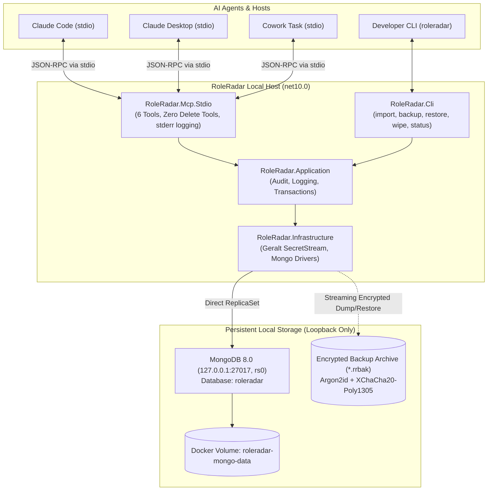

# RoleRadar

RoleRadar is a local-first, privacy-focused career memory and job search copilot datastore designed to give AI agents persistent, structured memory across applications, conversations, and interviews. RoleRadar operates entirely within your local security boundary: MongoDB binds exclusively to loopback (`127.0.0.1:27017`), the MCP server communicates over pure `stdio` child processes without opening any network listeners, and all backup archives are encrypted at rest with libsodium (`Geralt` 4.4.0 `IncrementalXChaCha20Poly1305` + `Argon2id`). Passphrases are never passed as command-line arguments, accepted only via interactive prompts, environment variables, or standard input, and are immediately zeroed in memory after use. No proprietary credentials, private notes, or real personal identities are ever stored in the repository.



---

## Quickstart (Under 10 Minutes)

### 1. Prerequisites

- [.NET 10 SDK](https://dotnet.microsoft.com/) (`10.0.100` or newer)
- [Docker Desktop](https://www.docker.com/products/docker-desktop/) or Docker Engine with Docker Compose v2
- PowerShell 7 (`pwsh`)

### 2. Start Services

Clone the repository and start the persistent, loopback-bound MongoDB replica set:

```powershell
git clone https://github.com/mwalczyk81/roleradar.git
cd roleradar

# Start local MongoDB replica set (rs0 on 127.0.0.1:27017)
pwsh ./scripts/start-services.ps1
```

Verify service readiness:

```powershell
dotnet run --project src/RoleRadar.Cli -- status
```

Expected output:

```text
RoleRadar Store: Ready
Endpoint:        127.0.0.1:27017 (rs0)
Replica Set:     rs0
Latency:         115.69 ms
```

### 3. Import Fictional Notes

RoleRadar ships with fictional test fixtures to populate initial memory without using real identities:

```powershell
# 1. Preview changes without writing to database
dotnet run --project src/RoleRadar.Cli -- import tests/fixtures/fictional-memory-primary.md --dry-run

# 2. Perform the import
dotnet run --project src/RoleRadar.Cli -- import tests/fixtures/fictional-memory-primary.md --default-date 2026-03-01
```

---

## MCP Client Registration

Build the MCP stdio server binaries:

```powershell
dotnet publish src/RoleRadar.Mcp.Stdio -c Release -o ./dist/mcp
```

The compiled binary will be located at `./dist/mcp/RoleRadar.Mcp.Stdio.exe` (or `RoleRadar.Mcp.Stdio.dll` run via `dotnet`).

### Claude Code CLI

Register RoleRadar into Claude Code (the target path must be absolute because Claude Code launches MCP servers from arbitrary working directories):

```powershell
claude mcp add roleradar -- dotnet C:/Users/<username>/source/repos/roleradar/dist/mcp/RoleRadar.Mcp.Stdio.dll
```

Or using the published Windows executable directly:

```powershell
claude mcp add roleradar -- C:/Users/<username>/source/repos/roleradar/dist/mcp/RoleRadar.Mcp.Stdio.exe
```

### Claude Desktop

Add RoleRadar to your Claude Desktop configuration (`%APPDATA%\Claude\claude_desktop_config.json`):

```json
{
  "mcpServers": {
    "roleradar": {
      "command": "dotnet",
      "args": [
        "C:/Users/<username>/source/repos/roleradar/dist/mcp/RoleRadar.Mcp.Stdio.dll"
      ],
      "env": {
        "ROLERADAR_MONGO_CONNECTION_STRING": "mongodb://127.0.0.1:27017/?replicaSet=rs0&directConnection=true",
        "ROLERADAR_MONGO_DATABASE": "roleradar"
      }
    }
  }
}
```

### Cowork / Scheduled Task

To launch RoleRadar in headless agentic workflows or scheduled background automation, execute:

```powershell
dotnet C:/Users/<username>/source/repos/roleradar/dist/mcp/RoleRadar.Mcp.Stdio.dll
```

Standard input/output will process JSON-RPC MCP messages, while diagnostic logs are routed exclusively to standard error to prevent protocol stream corruption.

---

## MCP Tool Surface

RoleRadar exposes exactly 6 high-level memory tools under a strict 8-tool ceiling with **zero hard-delete tools**:

| Tool Name | Purpose |
| :--- | :--- |
| `note_create` | Create a new durable note with title, body, area, and tags. |
| `note_get` | Retrieve a note by its identifier, including its active version token. |
| `note_append` | Atomically append content to an existing note under optimistic concurrency control. |
| `note_replace_section` | Replace or update a markdown section heading while creating an immutable `note_revision`. |
| `note_search` | Search notes across title, body, and tags (excludes archived notes by default). |
| `note_archive` | Mark a note as archived, preserving all content and revision history while hiding it from default search. |

---

## CLI Reference

RoleRadar includes the `roleradar` command-line utility (`src/RoleRadar.Cli`):

### `roleradar status`

Checks datastore readiness, round-trip ping latency, and cluster configuration.

- `--json`: Emit machine-readable JSON status output.

### `roleradar import <files...>`

Imports markdown documents into memory, preserving exact headings, sections, code blocks, and tags.

- `--dry-run`: Parse and reconcile notes against database without committing writes or audit entries.
- `--verbose`, `-v`: Output verbose diagnostic reconciliation logs to standard error.
- `--json`: Output full reconciliation summaries as JSON.
- `--default-date <YYYY-MM-DD>`: Fallback date for undated headings and tags.
- `--source-id <id>`: Custom provenance identifier for imported documents.
- `--area <area>`: Target area category (default: `imported`).

### `roleradar backup [destination]`

Creates a compressed, streaming passphrase-encrypted archive (`.rrbak`) of the database.

- `[destination]`: Target directory or file path (defaults to current directory).
- `--passphrase-env <VAR>`: Read encryption passphrase from the specified environment variable.
- `--passphrase-stdin`: Read encryption passphrase from standard input.

> [!NOTE]
> CLI arguments like `--passphrase <value>` are explicitly forbidden for security.
> **Backup Consistency Note**: Backups are guaranteed consistent only when no writes occur during the dump because MongoDB's `--oplog` flag cannot be replayed together with namespace filtering (`--nsInclude`).

### `roleradar restore <archive-path>`

Performs a strict two-pass verification and restore of an encrypted archive. Pass 1 validates the header, authentication tags, and archive magic numbers. Pass 2 restores data to MongoDB.

- `--passphrase-env <VAR>`: Read decryption passphrase from the specified environment variable.
- `--passphrase-stdin`: Read decryption passphrase from standard input.
- `--force-overwrite`: Required if the target database contains existing collections or notes.

### `roleradar wipe`

Resets and drops all notes, revisions, and audit collections in the database.

- `--confirm WIPE-ALL-ROLERADAR-DATA`: Mandatory safety token to confirm destruction.

---

## Environment Variables

| Variable | Default Value | Description |
| :--- | :--- | :--- |
| `ROLERADAR_MONGO_CONNECTION_STRING` | `mongodb://127.0.0.1:27017/?replicaSet=rs0&directConnection=true` | MongoDB connection string. Credentials are automatically redacted in logs and error messages. |
| `ROLERADAR_MONGO_DATABASE` | `roleradar` | Target database name. |
| `ROLERADAR_COMPOSE_FILE` | `<repo-root>/deploy/docker-compose.yml` | Path to the Docker Compose definition file. |
| `ROLERADAR_BACKUP_DUMP_COMMAND` | `docker compose -f <compose> exec -T mongo mongodump --archive --gzip --oplog` | Command executed to produce the plaintext backup stream. |
| `ROLERADAR_BACKUP_RESTORE_COMMAND` | `docker compose -f <compose> exec -T mongo mongorestore --archive --gzip --oplogReplay --nsInclude "<db>.*"` | Command executed to consume the restored plaintext stream. |
| `ROLERADAR_LOG_LEVEL` | `Warning` | Minimum logging verbosity for CLI (`Trace`, `Debug`, `Information`, `Warning`, `Error`). |

---

## Development & Security Guidelines

- Real names, personal addresses, and sensitive personal data must **never** be committed to this repository. See [docs/denylist.example.txt](docs/denylist.example.txt) for configuration of the pre-commit and pre-push sanitization hooks.
- Contribution guidelines and pull request conventions are detailed in [CONTRIBUTING.md](CONTRIBUTING.md).
