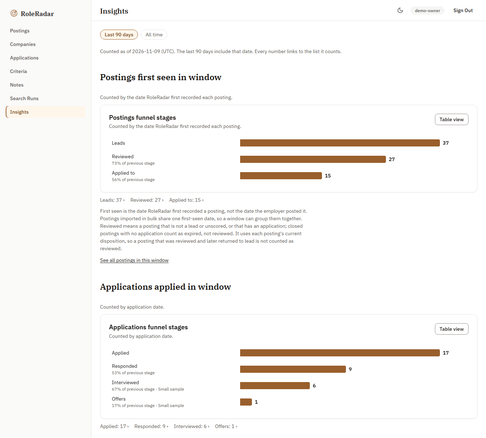
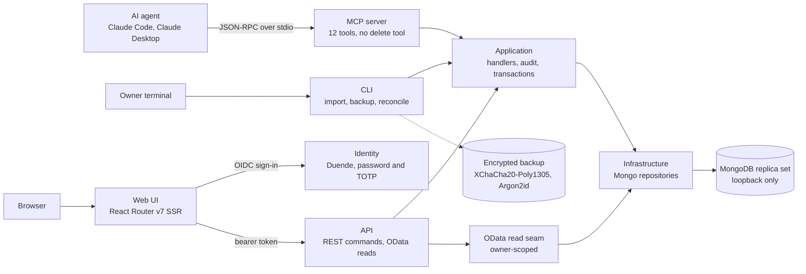

# RoleRadar

Long-term memory for AI agents over MCP, and a job-search tracker with a web UI, on one local data store.
Local-first by design: everything stays on your machine, every write is audited, and nothing is ever hard-deleted.

[](https://github.com/mwalczyk81/roleradar/actions/workflows/ci.yml)
[](https://mwalczyk81.github.io/roleradar/)
[](https://dashboard.stryker-mutator.io/reports/github.com/mwalczyk81/roleradar/main?module=web-lib)
[](LICENSE)
[](https://dotnet.microsoft.com/)

<picture>
  <source media="(prefers-color-scheme: dark)" srcset="docs/images/insights-dark.png">
  
</picture>

## Try the demo

You need Docker with Compose v2 ([versions](docs/demo.md#what-you-need)). Four steps:

1. Clone the repository.

   ```bash
   git clone https://github.com/mwalczyk81/roleradar.git
   cd roleradar
   ```

2. Start the demo stack. The first run builds four images, which takes a few minutes; later starts take about a minute.

   ```bash
   docker compose -p roleradar-demo -f deploy/demo/docker-compose.yml up --build --wait
   ```

3. Get the throwaway sign-in. It prints a username, a generated password and a TOTP secret, once, to your terminal.

   ```bash
   docker compose -p roleradar-demo -f deploy/demo/docker-compose.yml --profile tools run --rm demo-cli demo credentials
   ```

4. Open <https://localhost:5103> and sign in with those values and a code from your authenticator app (or from `demo totp`).

The demo uses self-signed certificates, so your browser warns: accept the warning once for each origin, `localhost:5103` and `identity.localhost:5101`.
**All demo data is fictional.** The companies, postings, notes and the account are invented and never leave your machine.
The demo is a separate Compose project on its own ports and volumes; remove it with `down -v` and the same `-p roleradar-demo`. Details, the guard that keeps it away from real data, and more pictures: [docs/demo.md](docs/demo.md).

## Architecture



Dependencies point one way: Domain, then Application, then Infrastructure, then the thin hosts (MCP server, CLI, API). Architecture tests fail the build if a layer reaches the wrong way or a command handler is registered without the transaction-and-audit decorator. Reads in the web UI go through one owner-scoped OData seam ([ADR 0028](docs/adr/0028-odata-read-seam-and-query-execution.md)); commands go through the same Application handlers the MCP tools use.

## How it was built

RoleRadar is built spec first with [GitHub Spec Kit](https://github.com/github/spec-kit). Every feature has a spec, a plan and a task list under [specs/](specs/), written before any code and kept in step with it.

- A [constitution](.specify/memory/constitution.md) of nine principles (privacy first, tests first, enforced layering, named seams only, untrusted posting text, stdout hygiene, durable data, ADRs for decisions, .NET 10 with UUIDv7 and UTC).
- About forty [architecture decision records](docs/adr/README.md), one per library choice or design decision, including the ones that were rejected.
- Tests first and shown failing, architecture tests for the layering, contract tests for the API and MCP schemas, and integration tests against throwaway Mongo containers only.
- A human review gate. Each phase stops for the owner's review, and the gate script rebuilds and retests a clean clone before a pull request.

**AI agents wrote much of the code, the tests and these docs, under that process.** The owner set the requirements, reviewed every phase stop and pull request, and made the calls recorded in the ADRs. The process is the point: specs, tests and gates are what keep agent-written code honest.

A worked example from spec to pull request is feature 008, rejecting an applied posting: [spec, plan and tasks](specs/008-posting-application-rejection-sync/), [ADR 0033](docs/adr/0033-posting-rejection-syncs-to-application.md) and [pull request #53](https://github.com/mwalczyk81/roleradar/pull/53).

The fast test loop (architecture, unit and contract tests):

```powershell
pwsh ./scripts/test-fast.ps1
```

The review gate (clean clone, format, build with warnings as errors, every test lane, coverage, image build and scan):

```powershell
pwsh ./scripts/review-gate.ps1
```

## Evidence

The [reports site](https://mwalczyk81.github.io/roleradar/) publishes the combined Allure test report, line coverage, trends over time and the mutation report from the nightly run.

- Domain and Application line coverage is held at 85 percent or more by the review gate and CI.
- Mutation testing covers the web library code with a committed floor of 81 ([ADR 0037](docs/adr/0037-mutation-testing.md)).
- Every image the gate builds is scanned with a pinned Trivy, and the gate cannot pass on a skipped scan ([ADR 0036](docs/adr/0036-test-lanes-and-gate-scan.md)).

## Status and limits

- **Local-first by design.** Mongo binds to loopback, the MCP server opens no network listener, and backups are encrypted at rest. There is no hosted version.
- **Hosting is parked.** Hosting would need a managed Mongo, a container runtime, a real identity provider and account management ([ADR 0011](docs/adr/0011-hosted-mongodb-selection-and-compatibility.md), [ADR 0012](docs/adr/0012-azure-container-runtime-target.md), both proposed only).
- **Single owner.** One owner id scopes every collection and every read; there are no other users.
- **Pre-1.0.** The first release is v0.1.0; interfaces can still change.

## Documentation

- [docs/README.md](docs/README.md) indexes everything under `docs/`, including the [ADR index](docs/adr/README.md) and the [demo](docs/demo.md).
- [MCP client registration](docs/mcp-clients.md), [MCP tools](docs/mcp-tools.md), [CLI reference](docs/cli-reference.md), [Insights](docs/insights.md), [backup and restore](docs/operations/backup-restore.md), [logs and health](docs/operations/logs-and-health.md).
- [Changelog](CHANGELOG.md): what changed in each release.

## Quickstart on the real stack

You need the .NET 10 SDK, Docker with Compose v2 and PowerShell 7. This starts the loopback Mongo replica set, checks it and imports fictional notes:

```powershell
git clone https://github.com/mwalczyk81/roleradar.git
cd roleradar
pwsh ./scripts/start-services.ps1
dotnet run --project src/RoleRadar.Cli -- status
dotnet run --project src/RoleRadar.Cli -- import tests/fixtures/fictional-memory-primary.md --default-date 2026-03-01
```

Then register the MCP server with your client ([docs/mcp-clients.md](docs/mcp-clients.md)).

## CLI and MCP reference

- CLI: `status`, `import`, `backup`, `restore`, `wipe` (needs a confirmation token), `reconcile-read-models` (dry run unless confirmed), and `demo` (demo stack only). Full options: [docs/cli-reference.md](docs/cli-reference.md).
- MCP tools: `note_create`, `note_get`, `note_append`, `note_replace_section`, `note_search`, `note_archive`, `company_record`, `posting_record`, `posting_transition`, `tracker_query`, `tracker_log`, `application_record`. No tool deletes anything. Details: [docs/mcp-tools.md](docs/mcp-tools.md).

## Environment Variables

| Variable | Default Value | Description |
| :--- | :--- | :--- |
| `ROLERADAR_MONGO_CONNECTION_STRING` | `mongodb://127.0.0.1:27017/?replicaSet=rs0&directConnection=true` | MongoDB connection string. Credentials are automatically redacted in logs and error messages. |
| `ROLERADAR_MONGO_DATABASE` | `roleradar` | Target database name. |
| `ROLERADAR_COMPOSE_FILE` | `<repo-root>/deploy/docker-compose.yml` | Path to the Docker Compose definition file. |
| `ROLERADAR_BACKUP_DUMP_COMMAND` | `docker compose -f <compose> exec -T mongo mongodump --archive --gzip --oplog` | Command executed to produce the plaintext backup stream. |
| `ROLERADAR_BACKUP_RESTORE_COMMAND` | `docker compose -f <compose> exec -T mongo mongorestore --archive --gzip --oplogReplay --nsInclude "<db>.*"` | Command executed to consume the restored plaintext stream. |
| `ROLERADAR_LOG_LEVEL` | `Warning` | Minimum logging verbosity for CLI (`Trace`, `Debug`, `Information`, `Warning`, `Error`). |

## Security and contributing

- Report vulnerabilities privately as described in [SECURITY.md](SECURITY.md).
- Real names, addresses and other personal data must never be committed; the pre-commit hooks scan for them against a private local list ([docs/denylist.example.txt](docs/denylist.example.txt)).
- How to contribute: [CONTRIBUTING.md](CONTRIBUTING.md). Everyone taking part follows the [code of conduct](CODE_OF_CONDUCT.md).
- Licensed under the [MIT License](LICENSE).
