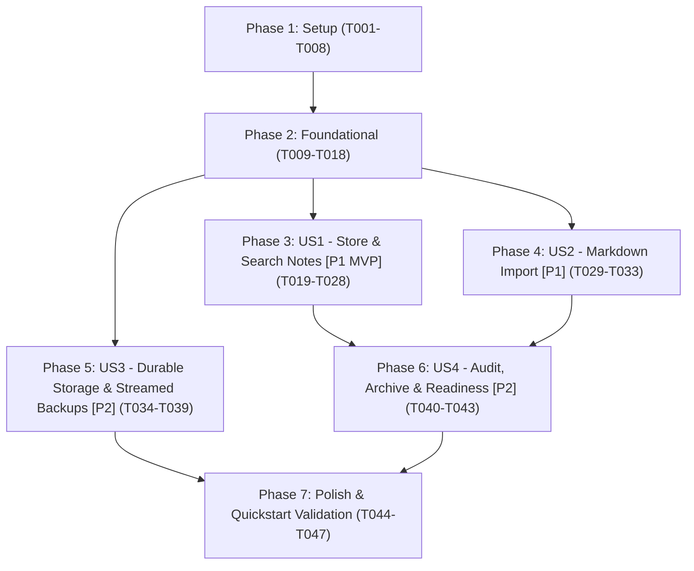

# Tasks: Memory Replacement

**Input**: Design documents from `/specs/001-memory-replacement/`

**Prerequisites**: [plan.md](./plan.md) (required), [spec.md](./spec.md) (required for user stories), [research.md](./research.md), [data-model.md](./data-model.md), [contracts/](./contracts/), [quickstart.md](./quickstart.md)

**Tests**: Tests are MANDATORY per Constitution Principle II (Test-First Development). For every user story, test tasks MUST come first, be marked as expected to fail, and precede all implementation tasks.

**Organization**: Tasks are grouped by user story (`US1`–`US4`) to enable independent implementation and testing of each story.

## Format: `[ID] [P?] [Story] Description`

- **[P]**: Can run in parallel (different files, no dependencies on incomplete tasks)
- **[Story]**: Which user story this task belongs to (`[US1]`, `[US2]`, `[US3]`, `[US4]`)
- Every task includes exact repository-relative file paths and quotes field constraints from `data-model.md` verbatim where applicable.

---

## Phase 1: Setup (Shared Infrastructure & Repository Standards)

**Purpose**: Initialize the `.NET 10` solution, repository standards, build/package pins, privacy guardrails, CI workflows, and fictional test fixtures.

- [X] T001 Create SDK pin (`10.0.402`, `rollForward: "latestPatch"`) and Git line-ending/binary fixture rules (`* text=auto eol=lf`, `*.ps1 text eol=crlf`, `tests/**/fixtures/** -text`) in `global.json` and `.gitattributes`
- [X] T002 Create build configuration (`TargetFramework=net10.0`, `Nullable=enable`, `TreatWarningsAsErrors=true`, `AnalysisLevel=latest-recommended`, `EnforceCodeStyleInBuild=true`, `RestorePackagesWithLockFile=true`, `NuGetAudit=true`, `NuGetAuditMode=all`, `NuGetAuditLevel=low`) and Central Package Management with live-verified pins (`ModelContextProtocol` `2.2.0`, `Microsoft.Extensions.Hosting` `10.0.13`, `MongoDB.Driver` `3.12.0`, `System.CommandLine` `2.0.13`, `Geralt` `4.4.0`, `xunit.v3` `4.0.2`, `xunit.runner.visualstudio` `4.0.1`, `Microsoft.NET.Test.Sdk` `18.11.0`, `Testcontainers.MongoDb` `4.16.0`, `NetArchTest.Rules` `1.3.2`, `coverlet.collector` `10.1.0`) in `Directory.Build.props` and `Directory.Packages.props`
- [X] T003 [P] Create C# formatting and analyzer rules enforced in the build in `.editorconfig`
- [X] T004 Scaffold `RoleRadar.sln`, all 5 source projects (`src/RoleRadar.Domain/RoleRadar.Domain.csproj`, `src/RoleRadar.Application/RoleRadar.Application.csproj`, `src/RoleRadar.Infrastructure/RoleRadar.Infrastructure.csproj`, `src/RoleRadar.Mcp.Stdio/RoleRadar.Mcp.Stdio.csproj`, `src/RoleRadar.Cli/RoleRadar.Cli.csproj`), and all 4 test projects (`tests/RoleRadar.Tests.Unit/RoleRadar.Tests.Unit.csproj`, `tests/RoleRadar.Tests.Architecture/RoleRadar.Tests.Architecture.csproj`, `tests/RoleRadar.Tests.Contract/RoleRadar.Tests.Contract.csproj`, `tests/RoleRadar.Tests.Integration/RoleRadar.Tests.Integration.csproj`) with project references and initial `packages.lock.json` files
- [X] T005 [P] Configure secret/pattern scanning rules, `.pre-commit-config.yaml` (`gitleaks`, `zizmor`, `markdownlint-cli2`, `roleradar-forbidden-paths`), and the local private-denylist script (`%LOCALAPPDATA%\roleradar\private\denylist.txt` per Constitution Principle I) in `.gitleaks.toml`, `.pre-commit-config.yaml`, and `scripts/denylist-check.ps1`
- [X] T006 [P] Create SHA-pinned GitHub Actions workflows for CI (including a `windows-latest` job running unit and architecture tests and `PSScriptAnalyzer` on `scripts/*.ps1`, and an `ubuntu-latest` job running `dotnet restore --locked-mode`, `dotnet format --verify-no-changes`, build, Testcontainers contract and integration tests with Linux containers, `>=85%` line coverage gate on `RoleRadar.Domain` and `RoleRadar.Application`, and `gitleaks`), CodeQL for C#, Dependency Review on pull requests, and Dependabot configuration (`nuget`, `docker`, `github-actions` with grouped minor/patch updates) in `.github/workflows/ci.yml`, `.github/workflows/codeql.yml`, `.github/workflows/dependency-review.yml`, and `.github/dependabot.yml`
- [X] T007 [P] Create strictly fictional markdown memory fixtures (`~46 KB` and `~26 KB`) containing `#`, `##`, and `###` headings, inline `[stated YYYY-MM-DD]`, `[researched YYYY-MM-DD qualifier]`, and undated `[inferred]` tags, `CRLF` and `LF` line endings, UTF-8 BOM, duplicate sibling headings, and empty headings in `tests/fixtures/fictional-memory-primary.md` and `tests/fixtures/fictional-memory-archive.md`
- [X] T008 [P] Create community and governance documentation files in `SECURITY.md`, `CONTRIBUTING.md`, `CODEOWNERS`, `.github/PULL_REQUEST_TEMPLATE.md`, `.github/ISSUE_TEMPLATE/bug_report.yml`, `.github/ISSUE_TEMPLATE/feature_request.yml`, and `docs/repo-settings.md`

---

## Phase 2: Foundational (Blocking Prerequisites)

**Purpose**: Core domain entities, typed `Result<T>` and handler/decorator abstractions, `INoteRepository` aggregate port, and MongoDB replica-set persistence infrastructure that MUST be complete before any user story can be implemented.

**⚠️ CRITICAL**: No user story work can begin until this phase is complete.

### Foundational Tests (MANDATORY - Test-First per Principle II & III) ⚠️

> **NOTE: Write these tests FIRST, ensure they FAIL before implementation**

- [X] T009 [P] Write failing architecture tests verifying one-way inward dependencies (`Domain` → `Application` → `Infrastructure` → `Hosts`), verifying no generic `IRepository<T>` exists, verifying that every `ICommandHandler<,>` implementation in `RoleRadar.Application` registered in `AddRoleRadarApplication()` is wrapped by `TransactionAndAuditCommandDecorator<,>` (Constitution v1.1.0 Principle III, checking each handler as it lands across phases), and verifying via reflection that `MongoNoteRepository` has no `Update*`, `Replace*`, or `Delete*` methods against `note_revisions` or `audit_log` and no `Delete*` method against `notes` (expected to fail before implementation) in `tests/RoleRadar.Tests.Architecture/LayeringAndAppendOnlyArchitectureTests.cs`
- [X] T010 [P] Write failing unit tests for `Note`, `NoteRevision`, `ProvenanceMarker`, `NoteImportMetadata`, `AuditLogEntry`, `Sha256Hasher`, and `Result<T>` domain invariants (expected to fail before implementation) in `tests/RoleRadar.Tests.Unit/Domain/NoteAndAuditDomainTests.cs`
- [X] T011 [P] Write failing `INoteRepository` contract test suite using `Testcontainers.MongoDb` `4.16.0` (`new MongoDbBuilder("mongo:8.0.34").WithReplicaSet("rs0").Build()`) including multi-document transaction fault-injection rollback verification (expected to fail before implementation) in `tests/RoleRadar.Tests.Contract/MongoNoteRepositoryContractTests.cs`

### Foundational Implementation

- [X] T012 [P] Implement common domain primitives (`OwnerId` with default `"local-owner"`, `IUtcClock` / `SystemUtcClock`, `Sha256Hasher` producing `"Lowercase hex SHA-256 of the UTF-8 bytes of body"`, and UUIDv7 generator `Guid.CreateVersion7()`) in `src/RoleRadar.Domain/Common/OwnerId.cs`, `src/RoleRadar.Domain/Common/IUtcClock.cs`, and `src/RoleRadar.Domain/Common/Sha256Hasher.cs` (depends on T010 failing first)
- [X] T013 [P] Implement `Note` aggregate root, `NoteRevision`, `ProvenanceMarker`, `NoteImportMetadata`, and `NoteStatus` in `src/RoleRadar.Domain/Notes/Note.cs`, `src/RoleRadar.Domain/Notes/NoteRevision.cs`, `src/RoleRadar.Domain/Notes/ProvenanceMarker.cs`, `src/RoleRadar.Domain/Notes/NoteImportMetadata.cs`, and `src/RoleRadar.Domain/Notes/NoteStatus.cs` (depends on T010 failing first), enforcing `data-model.md` constraints verbatim:
  - `Note._id`: Required, `"Primary identifier generated via Guid.CreateVersion7()"`
  - `Note.owner_id`: Required, `"Owner identifier (default \"local-owner\")"`
  - `Note.title`: Required, `"Note title (non-empty; bare headings during import receive deterministic placeholder e.g. \"(Untitled Heading #1)\")"`
  - `Note.body`: Required, `"Exact markdown body text (preserving original line endings CRLF/LF, UTF-8 BOM on preamble, and trailing newline; up to >=1 MB)"`
  - `Note.current_body_hash`: Required, `"Lowercase hex SHA-256 of the UTF-8 bytes of body"`
  - `Note.tags`: Required, `"Normalized (trimmed, lowercase, deduplicated) tags. Empty array [] when untagged."`
  - `Note.area`: Required, `"Normalized area label (e.g., \"criteria\", \"runbook\", \"preferences\", \"general\")"`
  - `Note.provenance`: Required, `"Embedded document: { kind: \"stated\" | \"researched\" | \"inferred\", date: \"YYYY-MM-DD\", qualifier: string? }"`
  - `Note.import_metadata`: Nullable, `"Populated for notes created/managed by markdown import; null for agent-created notes"` with required `import_key` (`"Deterministic composite key: \"{source_file_id}#{heading_path}#{occurrence_index}\""`), `source_file_id`, `heading_path`, `occurrence_index`, `section_order_index`, and `last_imported_body_hash` (`"Lowercase hex SHA-256 of the UTF-8 bytes of body at the time of the last import write. Compared against current_body_hash (excluding provenance.date) to detect post-import edits."`)
  - `Note.status`: Required, `"\"active\" or \"archived\""`
  - `Note.version_token`: Required, `"Concurrency token (Guid.CreateVersion7()), rotated on every write"`
  - `Note.revision_count`: Required, `"Count of destructive-edit revisions in note_revisions for this note (0 initially; incremented only on ReplaceNoteSection and ImportMarkdown overwrite, never on AppendToNote)"`
  - `Note.created_at` and `Note.updated_at`: Required UTC `DateTime`
  - `NoteRevision`: Required `_id` (`Guid.CreateVersion7()`), `owner_id`, `note_id`, `revision_number` (`"1-based monotonic revision sequence number for note_id"`), `reason` (`"\"replace-section\" or \"import-overwrite\""`), `prior_body` (`"Full exact markdown body of the note immediately prior to the destructive write"`), `prior_body_hash`, `prior_version_token`, and `created_at` (UTC)
- [X] T014 [P] Implement `AuditLogEntry`, `AuditContentSummary`, and `AuditOperation` in `src/RoleRadar.Domain/Audit/AuditLogEntry.cs`, `src/RoleRadar.Domain/Audit/AuditContentSummary.cs`, and `src/RoleRadar.Domain/Audit/AuditOperation.cs` (depends on T010 failing first), enforcing `data-model.md` constraints verbatim:
  - `_id`: Required, `"Audit entry identifier generated via Guid.CreateVersion7()"`
  - `owner_id`: Required, `"Owner identifier"`
  - `actor`: Required, `"Actor identity (e.g., \"mcp-stdio\", \"cli-import\")"`
  - `operation`: Required, `"Operation name: \"note_create\", \"note_append\", \"note_replace_section\", \"note_archive\", \"import_create\", or \"import_overwrite\""`
  - `target_note_id`: Required, `"Target notes._id"`
  - `note_revision_id`: Nullable, `"Populated only on note_replace_section and import_overwrite (references note_revisions._id); null on note_create, note_append, note_archive, and import_create"`
  - `appended_text`: Nullable, `"Populated only on note_append (stores the exact text appended); null for all other operations"`
  - `resulting_version_token`: Required, `"The note's new version_token after the write completes"`
  - `resolved_default_date`: Nullable, `"Populated on import_create and import_overwrite with the effective default provenance date (from --default-date or UTC file last-modified date); null otherwise"`
  - `occurred_at`: Required UTC `DateTime`
  - `before_summary`: Nullable, `"null on note_create / import_create; otherwise { body_hash: string, byte_length: int, status: string, excerpt: string }"`
  - `after_summary`: Required, `"{ body_hash: string, byte_length: int, status: string, excerpt: string } (first <=200 chars)"`
- [X] T015 Implement `Result<T>`, `ResultError`, `ErrorCode`, `ICommand<TResponse>`, `IQuery<TResponse>`, `ICommandHandler<TCommand, TResponse>`, `IQueryHandler<TQuery, TResponse>`, `INoteRepository`, and `INoteTransactionContext` per `contracts/note-repository-port.md` in `src/RoleRadar.Application/Abstractions/Result.cs`, `src/RoleRadar.Application/Abstractions/Messaging.cs`, and `src/RoleRadar.Application/Abstractions/INoteRepository.cs` (depends on T012, T013, T014)
- [X] T016 Implement `TransactionAndAuditCommandDecorator<TCommand, TResponse>`, `LoggingCommandDecorator<TCommand, TResponse>`, `LoggingQueryDecorator<TQuery, TResponse>`, and `AddRoleRadarApplication()` decorator registration helpers (`AddCommandHandler<TCommand, TResponse, THandler>` and `AddQueryHandler<TQuery, TResponse, THandler>` for incremental handler registration in T028, T033, and T043) in `src/RoleRadar.Application/Decorators/TransactionAndAuditCommandDecorator.cs`, `src/RoleRadar.Application/Decorators/LoggingDecorators.cs`, and `src/RoleRadar.Application/DependencyInjection.cs` (depends on T009 failing first and T015)
- [X] T017 Implement MongoDB global `GuidSerializer(GuidRepresentation.Standard)` registration, `MongoOptions`, and idempotent index initializer (`ux_notes_owner_import_key`, `ix_notes_fulltext` with `weights: { title: 10, body: 1 }` and `default_language: "english"`, `ix_notes_owner_status_area_tags_updated`, `ix_notes_import_reassembly`, `ux_note_revisions_note_revnum`, `ix_audit_log_target_note`, `ix_audit_log_chronological`) in `src/RoleRadar.Infrastructure/Mongo/MongoOptions.cs` and `src/RoleRadar.Infrastructure/Mongo/MongoBootstrapAndIndexes.cs` (depends on T011 failing first and T015)
- [X] T018 Implement `MongoReadinessProbe` (`<=3s` readiness check returning `ErrorCode.DatastoreOffline` with `pwsh ./scripts/start-services.ps1` remediation message, invoked by `TransactionAndAuditCommandDecorator` via `INoteRepository.CheckReadinessAsync`), `MongoNoteRepository`, and `MongoNoteTransactionContext` using `IClientSessionHandle.WithTransactionAsync` across `notes`, `note_revisions`, and `audit_log` (with fault-injection hook support for contract testing and zero update/delete methods on `note_revisions` or `audit_log`) in `src/RoleRadar.Infrastructure/Mongo/MongoReadinessProbe.cs`, `src/RoleRadar.Infrastructure/Mongo/MongoNoteRepository.cs`, and `src/RoleRadar.Infrastructure/DependencyInjection.cs` (depends on T009, T011 failing first and T016, T017)

**Checkpoint**: Foundation ready — `LayeringAndAppendOnlyArchitectureTests` (including decorator registration check), `NoteAndAuditDomainTests`, and `MongoNoteRepositoryContractTests` compile and pass. User story phases can now begin.

---

## Phase 3: User Story 1 - Store, Update, and Retrieve Searchable Notes (Priority: P1) 🎯 MVP

**Goal**: Enable the AI agent over `stdio` MCP to create notes (with title, markdown body up to >=1 MB, tags, area label, and provenance marker), read notes by ID, append atomically server-side without a version token or full-body revision snapshot, replace markdown heading sections with optimistic concurrency (`VersionToken`) and full prior-body revision snapshots, and search notes by case-insensitive stemmed words, quoted phrases, and ANDed tag/area filters in under 200 ms p95 across 5,000 notes.

**Independent Test**: Create a note via the MCP tool/handler, append content, replace a heading section, restart the session and MongoDB container, search by text and by tag/area, and retrieve the full note by ID.

### Tests for User Story 1 (MANDATORY - Test-First per Principle II) ⚠️

> **NOTE: Write these tests FIRST, ensure they FAIL before implementation**

- [X] T019 [P] [US1] Write failing unit tests for `MarkdownSectionParser` (heading hierarchy parsing, replacing a target section while leaving sibling sections and line endings untouched, returning `ErrorCode.SectionNotFound` when missing, and returning `ErrorCode.AmbiguousHeading` with available headings when duplicate headings match) (expected to fail before implementation) in `tests/RoleRadar.Tests.Unit/Notes/MarkdownSectionParserTests.cs`
- [X] T020 [P] [US1] Write failing unit tests for `CreateNoteCommandHandler`, `GetNoteQueryHandler`, `AppendToNoteCommandHandler`, `ReplaceNoteSectionCommandHandler`, and `SearchNotesQueryHandler` including typed `Result<T>` failure paths (`NotFound`, `StaleVersionToken`, `ValidationError`) (expected to fail before implementation) in `tests/RoleRadar.Tests.Unit/Notes/NoteHandlersUnitTests.cs`
- [X] T021 [P] [US1] Write failing integration and benchmark tests for US1 covering create, get, atomic concurrent appends from two sessions, version-checked section replacement with `NoteRevision` persistence, >100 KB (up to 1 MB) note bodies, persistence across container restart, 5,000-note search latency asserting p95 < 200 ms with stemmed whole words, quoted phrases, ANDed tag/area filters, and relevance → `updated_at` → `_id` ordering, and MCP `stdout` protocol hygiene test proving `RoleRadar.Mcp.Stdio` `stdout` emits exclusively valid JSON-RPC 2.0 frames with all logs routed to `stderr` (expected to fail before T028 implementation) in `tests/RoleRadar.Tests.Integration/Notes/NoteLifecycleAndSearchBenchmarkTests.cs`
- [X] T048 [P] [US1] Write failing unit tests for `GetNoteQueryHandler` paging (default cap of `200,000` characters, `offset`, `maxChars`, `totalChars`, `truncated`, `nextOffset`, no split inside a UTF-16 surrogate pair, and `offset` beyond the end returning an empty page) in `tests/RoleRadar.Tests.Unit/Notes/NoteHandlersUnitTests.cs`, and a failing integration test through the `note_get` MCP tool paging across a note over `1 MB` in `tests/RoleRadar.Tests.Integration/Notes/NoteLifecycleAndSearchBenchmarkTests.cs` (expected to fail before T049 implementation)

### Implementation for User Story 1

- [X] T022 [P] [US1] Implement `MarkdownSectionParser` supporting heading resolution, ambiguity detection, and byte/line-ending-preserving section replacement in `src/RoleRadar.Domain/Notes/MarkdownSectionParser.cs` (depends on T019 failing first)
- [X] T023 [P] [US1] Implement `CreateNoteCommand`, `NoteCreatedDto`, and `CreateNoteCommandHandler` in `src/RoleRadar.Application/Notes/Commands/CreateNoteCommand.cs` (depends on T020, T021 failing first)
- [X] T024 [P] [US1] Implement `GetNoteQuery`, `NoteDetailDto`, and `GetNoteQueryHandler` in `src/RoleRadar.Application/Notes/Queries/GetNoteQuery.cs` (depends on T020, T021 failing first)
- [X] T025 [P] [US1] Implement `AppendToNoteCommand`, `NoteUpdatedDto`, and `AppendToNoteCommandHandler` (executing an atomic append inside a snapshot transaction—read, append, hash, update—with transient-error retry without requiring a caller version token, creating no `NoteRevision` snapshot, and recording `appended_text` plus `resulting_version_token` in `audit_log`) in `src/RoleRadar.Application/Notes/Commands/AppendToNoteCommand.cs` (depends on T020, T021 failing first)
- [X] T026 [P] [US1] Implement `ReplaceNoteSectionCommand`, `NoteSectionReplacedDto`, and `ReplaceNoteSectionCommandHandler` (requiring caller `VersionToken`, returning `ErrorCode.StaleVersionToken` on mismatch, saving full prior body in `note_revisions` with `reason = "replace-section"`, and linking `note_revision_id` in `audit_log`) in `src/RoleRadar.Application/Notes/Commands/ReplaceNoteSectionCommand.cs` (depends on T020, T021 failing first and T022)
- [X] T027 [P] [US1] Implement `SearchNotesQuery`, `NoteSearchResponseDto`, and `SearchNotesQueryHandler` (case-insensitive whole-word stemmed matching, quoted phrase support, ANDed tag/area filters, `includeArchived` default `false`, ordered by relevance descending, then `updated_at` descending, then `_id` ascending) in `src/RoleRadar.Application/Notes/Queries/SearchNotesQuery.cs` (depends on T020, T021 failing first)
- [X] T028 [US1] Register the US1 handlers (`CreateNoteCommandHandler`, `AppendToNoteCommandHandler`, `ReplaceNoteSectionCommandHandler` wrapped by `TransactionAndAuditCommandDecorator` and `LoggingCommandDecorator`; `GetNoteQueryHandler`, `SearchNotesQueryHandler` wrapped by `LoggingQueryDecorator`) in `src/RoleRadar.Application/DependencyInjection.cs`, and implement `RoleRadar.Mcp.Stdio` host bootstrap (`ModelContextProtocol` `2.2.0`, `stderr`-only logging) and `NoteMcpTools` (`note_create`, `note_get`, `note_append`, `note_replace_section`, `note_search`) injecting handlers directly in `src/RoleRadar.Mcp.Stdio/Program.cs` and `src/RoleRadar.Mcp.Stdio/Tools/NoteMcpTools.cs` (depends on T021 failing first and T023, T024, T025, T026, T027)
- [X] T049 [US1] Implement `note_get` character paging (`offset`, `maxChars` default `200,000`, `totalChars`, `truncated`, `nextOffset`, empty page when `offset >= totalChars`, and UTF-16 surrogate-pair boundary protection so a page never starts or ends inside a surrogate pair) in `src/RoleRadar.Application/Notes/Queries/GetNoteQuery.cs` and `src/RoleRadar.Mcp.Stdio/Tools/NoteMcpTools.cs` (depends on T048 failing first)

**Checkpoint**: User Story 1 (MVP) is complete and independently verified by `MarkdownSectionParserTests`, `NoteHandlersUnitTests`, `NoteLifecycleAndSearchBenchmarkTests` (including MCP `stdout` hygiene), and `LayeringAndAppendOnlyArchitectureTests`.

---

## Phase 4: User Story 2 - Import Existing Markdown Memory Files Idempotently (Priority: P1)

**Goal**: Provide the `roleradar import` CLI command and `ImportMarkdownCommandHandler` that split UTF-8 markdown files on `#` and `##` headings while preserving 100% of original bytes verbatim (`CRLF`/`LF`, UTF-8 BOM, trailing newline, preamble, empty headings), extract the first inline provenance tag in document order (`[kind]`, `[kind YYYY-MM-DD]`, `[kind YYYY-MM-DD qualifier words]`), use `--default-date` or UTC file `LastWriteTimeUtc` for undated tags, skip post-import edited notes as conflicts (comparing body hash only), and report removed/renamed sections as orphans without deleting them.

**Independent Test**: Run `roleradar import` twice against the two fictional sample files (`~46 KB` and `~26 KB`), verify identical note counts after the second run, and reassemble the imported sections by `section_order_index` to confirm 100% byte-for-byte equality with the source files.

### Tests for User Story 2 (MANDATORY - Test-First per Principle II) ⚠️

> **NOTE: Write these tests FIRST, ensure they FAIL before implementation**

- [X] T029 [P] [US2] Write failing unit tests for strict UTF-8 validation (`throwOnInvalidBytes: true`), byte-exact markdown splitting (`#` and `##` outside fenced code blocks, preamble at `section_order_index = 0`, `CRLF`/`LF` and UTF-8 BOM preservation, duplicate sibling heading `occurrence_index`, empty headings, bare heading placeholder titles), and provenance tag extraction (`[kind]`, `[kind YYYY-MM-DD]`, `[kind YYYY-MM-DD qualifier words]`, first tag in document order, undated tag fallback) (expected to fail before implementation) in `tests/RoleRadar.Tests.Unit/Import/MarkdownSplitterAndProvenanceParserTests.cs`
- [X] T030 [P] [US2] Write failing integration tests for `ImportMarkdownCommandHandler` and `roleradar import` CLI command covering: 100% byte-exact round-trip reassembly of `tests/fixtures/fictional-memory-primary.md` and `tests/fixtures/fictional-memory-archive.md`, idempotent re-run with changed `--default-date` producing zero duplicates, in-place overwrite creating a `NoteRevision` (`"import-overwrite"`) when unmodified since import, conflict skipping when `current_body_hash != last_imported_body_hash`, orphan reporting when headings are deleted/renamed, and invalid UTF-8 file rejection before any database write (expected to fail before implementation) in `tests/RoleRadar.Tests.Integration/Import/MarkdownImportIntegrationTests.cs`

### Implementation for User Story 2

- [X] T031 [P] [US2] Implement `MarkdownImportParser` (strict UTF-8 validator, `#`/`##` byte-preserving splitter with fenced code block awareness, `import_key` and `section_order_index` calculation, and regex/span provenance parser) in `src/RoleRadar.Domain/Notes/MarkdownImportParser.cs` (depends on T029 failing first)
- [X] T032 [US2] Implement `ImportMarkdownCommand`, `ImportMarkdownSummaryDto`, and `ImportMarkdownCommandHandler` (reconciling unchanged, updated, conflicted, and orphaned sections using body-hash-only comparison and recording `resolved_default_date` in `audit_log`) in `src/RoleRadar.Application/Import/Commands/ImportMarkdownCommand.cs` (depends on T030 failing first and T031)
- [X] T033 [US2] Register `ImportMarkdownCommandHandler` (wrapped by `TransactionAndAuditCommandDecorator` and `LoggingCommandDecorator`) in `src/RoleRadar.Application/DependencyInjection.cs` and implement `roleradar import` CLI command using `System.CommandLine` `2.0.13` GA API (`Argument<string[]>`, `Option<string>`, `Command.SetAction`, `--area`, `--tags`, `--default-date`, `--json`) in `src/RoleRadar.Cli/Commands/ImportCommand.cs` and `src/RoleRadar.Cli/Program.cs` (depends on T032)
- [X] T050 [US2] Implement `--dry-run` and `--verbose` options for `roleradar import` CLI command and `ImportMarkdownCommand` (running full parse, reconciliation, and changed-since-import analysis with zero database writes and zero audit entries, displaying titles in the summary only when `--json` or `--verbose` is specified) in `src/RoleRadar.Application/Import/Commands/ImportMarkdownCommand.cs`, `src/RoleRadar.Cli/Commands/ImportCommand.cs`, and `src/RoleRadar.Cli/Program.cs` (depends on T030, T032, T033)

**Checkpoint**: User Stories 1 and 2 are both complete and independently verified.

---

## Phase 5: User Story 3 - Manage Durable Data Storage, Encrypted Backups, and Safe Resets (Priority: P2)

**Goal**: Provide single-command persistent volume startup (`deploy/docker-compose.yml` + `scripts/start-services.ps1`), streamed compressed passphrase-encrypted backups (`Geralt` `4.4.0` `IncrementalXChaCha20Poly1305` + `Argon2id` with zero plaintext temp files and strict pre-KDF/pre-allocation header and chunk length ceilings), two-pass encrypted restore refusing non-empty datastores by default, and confirmation-guarded wipe (`roleradar wipe` / `scripts/wipe-data.ps1`).

**Independent Test**: Start services, import fictional notes, run backup to a target folder (while verifying zero plaintext temp files are created), run wipe with explicit confirmation, run two-pass restore, and verify 100% of notes, revisions, and audit entries match pre-wipe state.

### Tests for User Story 3 (MANDATORY - Test-First per Principle II) ⚠️

> **NOTE: Write these tests FIRST, ensure they FAIL before implementation**

- [X] T034 [P] [US3] Write failing cryptographic unit tests for `SecretStreamBackupArchiveService` (`Geralt` `4.4.0` `IncrementalXChaCha20Poly1305` + `Argon2id`) covering all mandatory ADR-0007 vectors: deterministic known-answer vector, crafted header with `Argon2MemoryKiB` above 1 GiB (`1048576` KiB), `Argon2Iterations` above 10, an unknown `FormatVersion` (`!= 1`), or a chunk length prefix above 1 MiB (`1048576` bytes) rejected with a typed error **BEFORE** key derivation or any large allocation, wrong passphrase, flipped bit in header/length/ciphertext (reaching pre-KDF rejection or authentication failure without allocating attacker-chosen memory), truncated stream (missing `ChunkFlag.Final`), dropped chunk, reordered chunks, and bounded-memory (`<= 256 KiB` buffers) multi-megabyte synthetic stream processing (expected to fail before implementation) in `tests/RoleRadar.Tests.Unit/Backup/SecretStreamBackupCryptoTests.cs`
- [X] T035 [P] [US3] Write failing integration tests for `backup`, `restore`, and `wipe` CLI commands verifying: a host-to-compose connectivity check proving the host machine connects to the compose service initiated with member host `127.0.0.1:27017` (evaluating both replica-set topology discovery and `directConnection=true`), rejection of CLI passphrase value arguments, temp-directory file watcher proving zero plaintext files are created during backup/restore, corrupted final chunk failing in Restore Pass 1 and leaving MongoDB untouched, refusal to restore into a non-empty datastore without `--force-overwrite`, refusal to wipe without `--confirm WIPE-ALL-ROLERADAR-DATA`, and full backup → wipe → restore round-trip fidelity (expected to fail before implementation) in `tests/RoleRadar.Tests.Integration/Backup/BackupRestoreWipeIntegrationTests.cs`

### Implementation for User Story 3

- [X] T036 [P] [US3] Create `deploy/docker-compose.yml` configuring `mongo:8.0.34` as single-node replica set `rs0` initiated with member host `127.0.0.1:27017` so the host machine can connect directly (considering `directConnection=true` for single-node host connections), bound to `127.0.0.1:27017`, with named persistent volume `roleradar-mongo-data`, healthcheck, and `restart: unless-stopped`, verified by the host-to-compose connectivity test in `deploy/docker-compose.yml`
- [X] T037 [US3] Implement `SecretStreamBackupArchiveService` (`Geralt.Argon2id.DeriveKey`, 54-byte `"RRBK"` `v1` header authenticated as associated data, enforcing strict ceilings of `FormatVersion == 1`, `Argon2Iterations` in `[3, 10]`, `Argon2MemoryKiB` in `[65536, 1048576]` (`<= 1 GiB`), and chunk `CiphertextLength` in `[17, 1048576]` (`<= 1 MiB`) with a typed error **before** key derivation or buffer allocation, 64 KiB `Geralt.IncrementalXChaCha20Poly1305` chunk framing with `ChunkFlag.Final`, `mongodump --archive --gzip` stdout streaming, and two-pass restore verification before `mongorestore --archive --gzip`) in `src/RoleRadar.Infrastructure/Backup/SecretStreamBackupArchiveService.cs` (depends on T034, T035 failing first)
- [X] T038 [US3] Implement `roleradar backup`, `roleradar restore`, and `roleradar wipe` commands (reading passphrase only via interactive prompt, `--passphrase-env`, or `--passphrase-stdin`, rejecting `--passphrase` CLI values, enforcing non-empty datastore check on restore, and requiring `--confirm WIPE-ALL-ROLERADAR-DATA` on wipe) in `src/RoleRadar.Cli/Commands/BackupCommand.cs`, `src/RoleRadar.Cli/Commands/RestoreCommand.cs`, and `src/RoleRadar.Cli/Commands/WipeCommand.cs` (depends on T037)
- [X] T039 [P] [US3] Create Windows PowerShell operational wrapper scripts in `scripts/start-services.ps1`, `scripts/backup.ps1`, `scripts/restore.ps1`, and `scripts/wipe-data.ps1` (depends on T036, T038)

**Checkpoint**: User Story 3 is complete and independently verified by `SecretStreamBackupCryptoTests` and `BackupRestoreWipeIntegrationTests`.

---

## Phase 6: User Story 4 - Enforce Auditability, Archive-Only Deletion, and Clear Service Readiness Errors (Priority: P2)

**Goal**: Expose `note_archive` (completing the 6-tool MCP surface under the 8-tool cap with zero hard-delete tools), preserve full text and revisions on archive while excluding archived notes from default search, verify all 5 command handlers are audited end-to-end, and expose `roleradar status` returning an actionable `<5s` start-service message when MongoDB is offline.

**Independent Test**: Execute create, append, section-replace, import, and archive operations; verify every write records an append-only `audit_log` entry with before/after summaries and revision references on destructive edits; confirm archived notes are hidden from default search; stop the MongoDB container and verify an MCP tool call or `roleradar status` fails in `<5s` with the `pwsh ./scripts/start-services.ps1` instruction.

### Tests for User Story 4 (MANDATORY - Test-First per Principle II & III) ⚠️

> **NOTE: Write these tests FIRST, ensure they FAIL before implementation**

- [X] T040 [P] [US4] Write failing architecture tests verifying that `NoteMcpTools` exposes `<= 8` tools (`6` expected: `note_create`, `note_get`, `note_append`, `note_replace_section`, `note_search`, `note_archive`) with zero delete tools (expected to fail before `note_archive` is added in T043) in `tests/RoleRadar.Tests.Architecture/McpToolSurfaceArchitectureTests.cs`
- [X] T041 [P] [US4] Write failing integration tests for `ArchiveNoteCommandHandler` / `note_archive` (archiving preserves body and revisions, hides note from default `note_search`, returns note on `note_get` and `includeArchived: true`), end-to-end `audit_log` inspection across all 5 write operations (`CreateNote`, `AppendToNote`, `ReplaceNoteSection`, `ArchiveNote`, `ImportMarkdown`), and `<5s` offline readiness error on MCP tool calls and `roleradar status` returning `pwsh ./scripts/start-services.ps1` (expected to fail before implementation) in `tests/RoleRadar.Tests.Integration/Safety/AuditArchiveAndReadinessIntegrationTests.cs`

### Implementation for User Story 4

- [X] T042 [P] [US4] Implement `ArchiveNoteCommand`, `NoteArchivedDto`, and `ArchiveNoteCommandHandler` (reading the `Note` and its current `VersionToken` inside the active transaction, passing `note.VersionToken` as `expectedVersionToken` to `INoteTransactionContext.ArchiveAsync`, marking `status = "archived"` without altering `body` or `note_revisions`, rotating `version_token`, and recording `"note_archive"` in `audit_log`) in `src/RoleRadar.Application/Notes/Commands/ArchiveNoteCommand.cs` (depends on T040, T041 failing first)
- [X] T043 [US4] Add `note_archive` tool to `src/RoleRadar.Mcp.Stdio/Tools/NoteMcpTools.cs`, register `ArchiveNoteCommandHandler` (wrapped by `TransactionAndAuditCommandDecorator` and `LoggingCommandDecorator`, completing all 5 command handlers) in `src/RoleRadar.Application/DependencyInjection.cs`, and implement `StatusCommand` (`roleradar status [--json]`) and readiness message formatting in `src/RoleRadar.Cli/Commands/StatusCommand.cs` and `src/RoleRadar.Cli/Program.cs` (depends on T040, T041 failing first and T042)

**Checkpoint**: All 4 user stories (`US1`–`US4`) are complete and independently verified.

---

## Phase 7: Polish & Cross-Cutting Concerns

**Purpose**: Finalize repository documentation, lock files, formatting, coverage gate verification, and clean-clone quickstart validation.

- [X] T044 [P] Write root `README.md` with `<10 minute` clean-clone quickstart, MCP client registration guide, CLI command reference, and Mermaid architecture diagram in `README.md`
- [X] T045 Synchronize NuGet `packages.lock.json` files across all projects (`dotnet restore RoleRadar.sln --use-lock-file` followed by `dotnet restore RoleRadar.sln --locked-mode`) and verify zero formatting/analyzer diffs (`dotnet format RoleRadar.sln --verify-no-changes`) in `RoleRadar.sln`
- [X] T046 Run full test suite (`dotnet test RoleRadar.sln -c Release --collect:"XPlat Code Coverage"`), verify `>=85%` line coverage across `RoleRadar.Domain` and `RoleRadar.Application`, and execute `pre-commit run --all-files` from the repository root (`.pre-commit-config.yaml`, `scripts/denylist-check.ps1`)
- [X] T047 Execute all end-to-end validation steps in `specs/001-memory-replacement/quickstart.md` (service start, two-file idempotent import, MCP stdio smoke test, streamed backup, unconfirmed/confirmed wipe, and two-pass restore) in `specs/001-memory-replacement/quickstart.md`

---

## Dependencies & Execution Order

### Phase Dependencies



- **Setup (Phase 1)**: No dependencies — starts immediately.
- **Foundational (Phase 2)**: Depends on Setup (`Phase 1`) — **BLOCKS all user stories**.
- **User Story 1 (`Phase 3`, P1 MVP)**: Depends on Foundational (`Phase 2`).
- **User Story 2 (`Phase 4`, P1)**: Depends on Foundational (`Phase 2`); can run in parallel with `US1` or immediately after `US1`.
- **User Story 3 (`Phase 5`, P2)**: Depends on Foundational (`Phase 2`); can run in parallel with `US1`/`US2`.
- **User Story 4 (`Phase 6`, P2)**: Completes `ArchiveNote`, MCP tool-surface architecture verification (`<= 8` tools, `6` expected, zero delete tools), end-to-end audit verification across all 5 write operations, and `roleradar status`.
- **Polish (`Phase 7`)**: Depends on `US1`–`US4` completion.

### Within Each User Story

1. **Tests FIRST (MANDATORY per Principle II)**: All `[USx]` test tasks (`T019`–`T021`, `T029`–`T030`, `T034`–`T035`, `T040`–`T041`) MUST be written first and verified to fail before the corresponding implementation tasks begin.
2. **Domain Parsers / Models** before **Application Command/Query Handlers**.
3. **Application Handlers** before **MCP Stdio Tools / CLI Commands**.

---

## Parallel Opportunities & Examples

### Parallel Example: Phase 1 (Setup)
```text
Task T003: Create .editorconfig
Task T005: Create .gitleaks.toml, .pre-commit-config.yaml, and scripts/denylist-check.ps1
Task T006: Create .github/workflows/ci.yml, codeql.yml, dependency-review.yml, and dependabot.yml
Task T007: Create tests/fixtures/fictional-memory-primary.md and fictional-memory-archive.md
Task T008: Create SECURITY.md, CONTRIBUTING.md, CODEOWNERS, PR/Issue templates, and docs/repo-settings.md
```

### Parallel Example: User Story 1 (MVP)
```text
# 1. Write all failing tests for US1 in parallel first:
Task T019: MarkdownSectionParserTests in tests/RoleRadar.Tests.Unit/Notes/MarkdownSectionParserTests.cs
Task T020: NoteHandlersUnitTests in tests/RoleRadar.Tests.Unit/Notes/NoteHandlersUnitTests.cs
Task T021: NoteLifecycleAndSearchBenchmarkTests in tests/RoleRadar.Tests.Integration/Notes/NoteLifecycleAndSearchBenchmarkTests.cs

# 2. Implement Domain parser and Application handlers in parallel once tests fail:
Task T022: MarkdownSectionParser in src/RoleRadar.Domain/Notes/MarkdownSectionParser.cs
Task T023: CreateNoteCommandHandler in src/RoleRadar.Application/Notes/Commands/CreateNoteCommand.cs
Task T024: GetNoteQueryHandler in src/RoleRadar.Application/Notes/Queries/GetNoteQuery.cs
Task T025: AppendToNoteCommandHandler in src/RoleRadar.Application/Notes/Commands/AppendToNoteCommand.cs
Task T027: SearchNotesQueryHandler in src/RoleRadar.Application/Notes/Queries/SearchNotesQuery.cs
```

### Parallel Example: User Story 2 & User Story 3
```text
# US2 and US3 touch disjoint files (Import/ vs Backup/ & deploy/) and can run concurrently after Phase 2:
Task T029 + T031: MarkdownSplitterAndProvenanceParserTests & MarkdownImportParser
Task T034 + T037: SecretStreamBackupCryptoTests & SecretStreamBackupArchiveService
Task T036: deploy/docker-compose.yml
```

---

## Implementation Strategy

### MVP First (User Story 1 Only)
1. Complete **Phase 1: Setup** (`T001`–`T008`).
2. Complete **Phase 2: Foundational** (`T009`–`T018`) — verify architecture (including decorator registration check), domain unit, and `INoteRepository` contract tests pass.
3. Complete **Phase 3: User Story 1** (`T019`–`T028`) — verify failing tests first, then implement handlers and `RoleRadar.Mcp.Stdio`.
4. **STOP and VALIDATE**: Confirm agent note creation, retrieval, atomic append, versioned section replacement, MCP `stdout` protocol hygiene, and `<200 ms` p95 search across 5,000 notes.

### Incremental Delivery
1. **Increment 1 (`Phase 1` + `Phase 2` + `US1`)**: Functional `stdio` MCP server for creating, updating, and searching durable notes.
2. **Increment 2 (`US2`)**: Add `roleradar import` to migrate existing markdown memory files with 100% byte-for-byte fidelity and conflict/orphan safety.
3. **Increment 3 (`US3`)**: Add `deploy/docker-compose.yml`, streamed `Geralt` (`IncrementalXChaCha20Poly1305` + `Argon2id`) backups with pre-KDF header ceilings, two-pass restore, and confirmation-guarded wipe.
4. **Increment 4 (`US4` + `Phase 7`)**: Add `note_archive`, MCP tool-surface architecture verification, end-to-end audit and `<5s` `roleradar status` readiness checks, and clean-clone quickstart sign-off.
