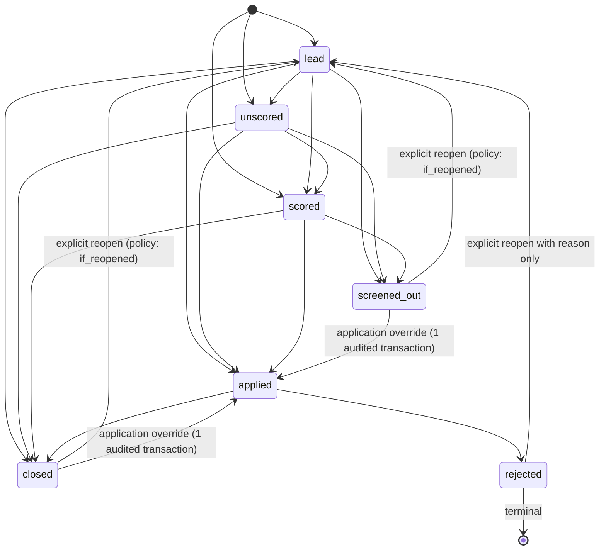

# Data Model Specification: Structured Job-Search Tracking

**Feature**: `002-job-search-tracking`  
**Date**: 2026-10-17  
**Status**: Completed (Phase 1 Output)

---

## 1. Overview & Storage Architecture

All structured entities live in dedicated MongoDB collections within the `roleradar` database on the single-node replica set (`rs0`).

### Universal Document Invariants
1. **`owner_id` (Mandatory)**: Every document across all collections MUST carry an `owner_id` string matching the authenticated single-owner identifier.
2. **`id` (Version 7 UUID)**: All document identifiers are generated as UUIDv7 strings (`Guid.CreateVersion7().ToString()`) providing chronological sortability and global uniqueness.
3. **`version_token` (Optimistic Concurrency)**: Modifiable aggregate root documents (`postings`, `companies`, `applications`, `contacts`, `notes`) carry a `version_token` (SHA-256 hash or UUID) rotated upon every update. Updates MUST enforce optimistic concurrency by asserting `version_token == expectedVersionToken`.
4. **Zero Hard Deletes**: No document is ever removed via database delete commands. Inactive entities are represented exclusively via statuses (`closed`, `screened_out`, `rejected`, `superseded`, `redacted`, `avoid`).
5. **Audit Invariance**: Every write (insert, update, state transition, redaction) writes exactly one append-only entry to `audit_log` inside the same multi-document database transaction.

---

## 2. Collections & Schemas

### 2.1. `companies`
Represents target employers and organizations.

```json
{
  "_id": "0192e401-0000-7000-8000-000000000001",
  "owner_id": "owner-1",
  "name": "Acme Software Corp",
  "normalized_name": "acme software corp",
  "description": "Enterprise cloud compliance and infrastructure software; VC-backed Series B; HQ in Austin.",
  "parent_company": "Acme Holdings LLC",
  "ownership_type": "vc_backed",
  "headquarters": "Austin, TX",
  "category_tags": ["cloud", "infrastructure", "security"],
  "status": "target",
  "last_checked_at": "2026-10-17T12:00:00Z",
  "last_check_result": "2 active .NET senior positions found",
  "version_token": "a1b2c3d4...",
  "created_at": "2026-10-17T12:00:00Z",
  "updated_at": "2026-10-17T12:00:00Z"
}
```

#### Fields & Constraints:
- `name` (string, mandatory, max 150 chars).
- `normalized_name` (string, computed lowercase trimmed, for indexing).
- `description` (string, optional, max 300 chars, covers industry/ownership/HQ notes).
- `parent_company` (string, optional, max 150 chars).
- `ownership_type` (string enum: `public`, `private`, `pe_backed`, `vc_backed`, `mutual`, `subsidiary`, `nonprofit`, `government`, `unknown`).
- `headquarters` (string, optional, max 150 chars).
- `category_tags` (array of strings, max 20 tags, each max 50 chars).
- `status` (string enum: `target`, `watch`, `avoid`, `neutral`, default: `neutral`).
- `last_checked_at` (UTC timestamp, optional).
- `last_check_result` (string, optional, max 300 chars).

#### Indexes:
1. `owner_id_1_normalized_name_1`: `{ owner_id: 1, normalized_name: 1 }` (unique).
2. `owner_id_1_status_1`: `{ owner_id: 1, status: 1 }`.

---

### 2.2. `career_sources`
Defines how to access openings for a company.

```json
{
  "_id": "0192e401-0000-7000-8000-000000000002",
  "owner_id": "owner-1",
  "company_id": "0192e401-0000-7000-8000-000000000001",
  "ats_type": "Greenhouse",
  "tenant": "acmesoftware",
  "slug": "acme-careers",
  "fetch_method": "api",
  "notes": "Greenhouse public API boards.greenhouse.io/v1/boards/acmesoftware/jobs",
  "created_at": "2026-10-17T12:00:00Z",
  "updated_at": "2026-10-17T12:00:00Z"
}
```

#### Fields & Constraints:
- `company_id` (string, mandatory UUIDv7).
- `ats_type` (string enum: `Workday`, `Greenhouse`, `Ashby`, `Lever`, `Avature`, `Oracle`, `UKG`, `Custom`).
- `tenant` (string, optional, max 100 chars).
- `slug` (string, optional, max 150 chars).
- `fetch_method` (string enum: `api`, `browser`, `blocked`).
- `notes` (string, optional, max 500 chars).

#### Indexes:
1. `owner_id_1_company_id_1`: `{ owner_id: 1, company_id: 1 }`.
2. `owner_id_1_ats_type_1_tenant_1`: `{ owner_id: 1, ats_type: 1, tenant: 1 }`.

---

### 2.3. `postings`
Core job opportunity record with multi-tier deduplication and screening memory.

```json
{
  "_id": "0192e401-0000-7000-8000-000000000003",
  "owner_id": "owner-1",
  "company_id": "0192e401-0000-7000-8000-000000000001",
  "title": "Staff Backend Engineer",
  "normalized_title": "staff backend engineer",
  "original_url": "https://boards.greenhouse.io/acmesoftware/jobs/4012948002?gh_src=linkedin",
  "normalized_url": "https://boards.greenhouse.io/acmesoftware/jobs/4012948002",
  "source_kind": "ats",
  "ats_tenant": "acmesoftware",
  "requisition_id": "4012948002",
  "location": "Austin, TX (Hybrid)",
  "remote_type": "hybrid",
  "compensation": {
    "min": 175000,
    "max": 205000,
    "currency": "USD",
    "text": "$175,000 - $205,000 + equity + 401(k) match"
  },
  "posted_date": "2026-10-15",
  "first_seen_at": "2026-10-16T14:30:00Z",
  "last_verified_at": "2026-10-17T09:00:00Z",
  "closed_date": null,
  "score": 8.5,
  "culture_level": "stable",
  "culture_summary": "High engineering autonomy, transparent roadmap, strong tenure.",
  "disposition": "scored",
  "disposition_reason": "Matches staff backend tech stack criterion; compensation meets preference.",
  "disposition_criterion_id": "0192e401-0000-7000-8000-000000000010",
  "resurface_policy": "never",
  "duplicate_of_id": null,
  "screening_note_id": "0192e401-0000-7000-8000-000000000099",
  "version_token": "b2c3d4e5...",
  "created_at": "2026-10-16T14:30:00Z",
  "updated_at": "2026-10-17T09:00:00Z"
}
```

#### Fields & Constraints:
- `company_id` (string, mandatory UUIDv7).
- `title` (string, mandatory, max 200 chars).
- `normalized_title` (string, computed lowercase alphanumeric-clean).
- `original_url` (string, mandatory, max 1000 chars).
- `normalized_url` (string, mandatory, max 1000 chars, stripped of tracking params).
- `source_kind` (string enum: `ats`, `aggregator`).
- `ats_tenant` (string, optional, max 100 chars).
- `requisition_id` (string, optional, max 100 chars).
- `location` (string, optional, max 150 chars).
- `remote_type` (string enum: `remote`, `hybrid`, `onsite`, `unknown`, default: `unknown`).
- `compensation`: subdocument with `min` (decimal?), `max` (decimal?), `currency` (string, 3 chars, default: `USD`), `text` (string, max 300 chars).
- `posted_date` (string, ISO 8601 date-only `YYYY-MM-DD`, optional).
- `first_seen_at` (UTC timestamp, mandatory).
- `last_verified_at` (UTC timestamp, mandatory).
- `closed_date` (string, ISO 8601 date-only `YYYY-MM-DD`, optional).
- `score` (decimal, optional, validated `0.0 <= score <= 10.0`).
- `culture_level` (string enum: `stable`, `moderate`, `high_risk`, `unknown`, default: `unknown`).
- `culture_summary` (string, optional, max 500 chars).
- `disposition` (string enum: `lead`, `scored`, `applied`, `rejected`, `screened_out`, `closed`, `unscored`, default: `lead`).
- `disposition_reason` (string, optional, max 500 chars).
- `disposition_criterion_id` (string, optional UUIDv7).
- `resurface_policy` (string enum: `never`, `if_reopened`, default: `never`).
- `duplicate_of_id` (string, optional UUIDv7; cannot equal `_id`; duplicate chains collapsed upon write).
- `screening_note_id` (string, optional UUIDv7).

#### Deduplication & Query Indexes:
1. **Tier A Unique Index**:
   ```javascript
   db.postings.createIndex(
     { owner_id: 1, ats_tenant: 1, requisition_id: 1 },
     {
       unique: true,
       partialFilterExpression: {
         ats_tenant: { $type: "string" },
         requisition_id: { $type: "string" }
       }
     }
   )
   ```
2. **Tier B Unique Index**:
   ```javascript
   db.postings.createIndex(
     { owner_id: 1, normalized_url: 1 },
     { unique: true }
   )
   ```
3. **Tier C Unique Index**:
   ```javascript
   db.postings.createIndex(
     { owner_id: 1, company_id: 1, requisition_id: 1 },
     {
       unique: true,
       partialFilterExpression: {
         requisition_id: { $type: "string" }
       }
     }
   )
   ```
4. **Tier D Advisory Lookup Index**:
   ```javascript
   db.postings.createIndex(
     { owner_id: 1, company_id: 1, normalized_title: 1 }
   )
   ```
5. **Decided Postings Compact Query Index**:
   ```javascript
   db.postings.createIndex(
     { owner_id: 1, disposition: 1, resurface_policy: 1 }
   )
   ```
6. **Company Postings Listing Index**:
   ```javascript
   db.postings.createIndex(
     { owner_id: 1, company_id: 1, disposition: 1 }
   )
   ```

---

### 2.4. `posting_signals`
Append-only log of quality, risk, and deadline signals attached to postings.

```json
{
  "_id": "0192e401-0000-7000-8000-000000000004",
  "owner_id": "owner-1",
  "posting_id": "0192e401-0000-7000-8000-000000000003",
  "signal_type": "deadline",
  "evidence": "Posting states applications close on 2026-11-01 11:59pm EST.",
  "deadline_date": "2026-11-01",
  "observed_at": "2026-10-17T14:00:00Z"
}
```

#### Fields & Constraints:
- `posting_id` (string, mandatory UUIDv7).
- `signal_type` (string enum: `repost`, `no_salary`, `parallel_posting`, `gone`, `phantom`, `deadline`).
- `evidence` (string, mandatory, max 500 chars).
- `deadline_date` (string, optional date-only `YYYY-MM-DD`, used when `signal_type == "deadline"`).
- `observed_at` (UTC timestamp, mandatory).

#### Indexes:
1. `owner_id_1_posting_id_1_observed_at_desc`: `{ owner_id: 1, posting_id: 1, observed_at: -1 }`.

---

### 2.5. `criteria`
Screening rules with immutable temporal versioning.

```json
{
  "_id": "0192e401-0000-7000-8000-000000000010",
  "owner_id": "owner-1",
  "key": "min_base_salary",
  "category": "hard_skip",
  "value": "165000",
  "effective_from": "2026-10-01T00:00:00Z",
  "effective_to": null,
  "provenance": "stated",
  "is_active": true,
  "created_at": "2026-10-01T00:00:00Z"
}
```

#### Fields & Constraints:
- `key` (string, mandatory, max 100 chars, e.g. `min_base_salary`, `tech_stack_dotnet`).
- `category` (string enum: `hard_skip`, `weight`, `preference`).
- `value` (string, mandatory, max 500 chars).
- `effective_from` (UTC timestamp, mandatory).
- `effective_to` (UTC timestamp, optional, populated when superseded).
- `provenance` (string enum: `stated`, `inferred`).
- `is_active` (boolean, mandatory; false when superseded or deactivated).

#### Indexes:
1. `owner_id_1_key_1_is_active_1`: `{ owner_id: 1, key: 1, is_active: 1 }`.
2. `owner_id_1_effective_from_1_effective_to_1`: `{ owner_id: 1, effective_from: 1, effective_to: 1 }`.

---

### 2.6. `applications`
Submissions tracking linked to a posting.

```json
{
  "_id": "0192e401-0000-7000-8000-000000000020",
  "owner_id": "owner-1",
  "posting_id": "0192e401-0000-7000-8000-000000000003",
  "submitted_date": "2026-10-17",
  "desired_salary_range": "$185,000 - $200,000",
  "target_start_date": "2026-12-01",
  "resume_variant": "tailored",
  "resume_pointer": "local://resumes/acme-staff-2026.pdf",
  "referral_contact_id": "0192e401-0000-7000-8000-000000000030",
  "confirmation_code": "APP-2026-89412",
  "outcome": "applied",
  "version_token": "c3d4e5f6...",
  "created_at": "2026-10-17T15:00:00Z",
  "updated_at": "2026-10-17T15:00:00Z"
}
```

#### Fields & Constraints:
- `posting_id` (string, mandatory UUIDv7).
- `submitted_date` (string, date-only `YYYY-MM-DD`, mandatory).
- `desired_salary_range` (string, optional, max 100 chars).
- `target_start_date` (string, date-only `YYYY-MM-DD`, optional).
- `resume_variant` (string enum: `tailored`, `as_is`, `ic_framed`, mandatory).
- `resume_pointer` (string, optional, max 300 chars; file content itself is FORBIDDEN).
- `referral_contact_id` (string, optional UUIDv7).
- `confirmation_code` (string, optional, max 100 chars).
- `outcome` (string enum: `applied`, `rejected`, `closed`, default: `applied`).

#### Indexes:
1. `owner_id_1_posting_id_1`: `{ owner_id: 1, posting_id: 1 }` (unique: one application per posting).
2. `owner_id_1_outcome_1`: `{ owner_id: 1, outcome: 1 }`.

---

### 2.7. `application_events`
Chronological interaction milestones on an application timeline.

```json
{
  "_id": "0192e401-0000-7000-8000-000000000021",
  "owner_id": "owner-1",
  "application_id": "0192e401-0000-7000-8000-000000000020",
  "event_date": "2026-10-17",
  "event_type": "applied",
  "event_source": "greenhouse_portal",
  "notes": "Application submitted via Greenhouse direct portal.",
  "created_at": "2026-10-17T15:00:00Z"
}
```

#### Fields & Constraints:
- `application_id` (string, mandatory UUIDv7).
- `event_date` (string, date-only `YYYY-MM-DD`, mandatory).
- `event_type` (string enum: `applied`, `follow_up`, `rejected`, `interview`, `offer`, `withdrawn`).
- `event_source` (string, optional, max 100 chars).
- `notes` (string, optional, max 500 chars).

#### Indexes:
1. `owner_id_1_application_id_1_event_date_1`: `{ owner_id: 1, application_id: 1, event_date: 1 }`.

---

### 2.8. `contacts`
Confidential third-party professional network directory.

```json
{
  "_id": "0192e401-0000-7000-8000-000000000030",
  "owner_id": "owner-1",
  "name": "Jane Doe",
  "role": "Lead Technical Recruiter",
  "company_name": "Acme Software Corp",
  "company_id": "0192e401-0000-7000-8000-000000000001",
  "relationship": "recruiter",
  "notes": "Connected via LinkedIn Oct 2026.",
  "is_redacted": false,
  "version_token": "d4e5f6g7...",
  "created_at": "2026-10-17T10:00:00Z",
  "updated_at": "2026-10-17T10:00:00Z"
}
```

#### Redacted State Example:
```json
{
  "_id": "0192e401-0000-7000-8000-000000000030",
  "owner_id": "owner-1",
  "name": "[REDACTED]",
  "role": null,
  "company_name": null,
  "company_id": null,
  "relationship": "redacted",
  "notes": null,
  "is_redacted": true,
  "version_token": "e5f6g7h8...",
  "created_at": "2026-10-17T10:00:00Z",
  "updated_at": "2026-10-17T16:00:00Z"
}
```

#### Fields & Constraints:
- `name` (string, mandatory, max 150 chars).
- `role` (string, optional, max 150 chars).
- `company_name` (string, optional, max 150 chars).
- `company_id` (string, optional UUIDv7).
- `relationship` (string enum: `recruiter`, `referral`, `hiring_manager`, `peer`, `redacted`).
- `notes` (string, optional, max 500 chars).
- `is_redacted` (boolean, default: false).

#### Indexes:
1. `owner_id_1_is_redacted_1`: `{ owner_id: 1, is_redacted: 1 }`.

---

### 2.9. `search_runs`
Search batch execution logging and narrative linkage.

```json
{
  "_id": "0192e401-0000-7000-8000-000000000040",
  "owner_id": "owner-1",
  "started_at": "2026-10-17T08:00:00Z",
  "new_postings_count": 7,
  "report_note_id": "0192e401-0000-7000-8000-000000000099",
  "notes": "Weekly target sweep covering 12 target companies.",
  "created_at": "2026-10-17T08:15:00Z"
}
```

#### Fields & Constraints:
- `started_at` (UTC timestamp, mandatory).
- `new_postings_count` (integer, >= 0).
- `report_note_id` (string, optional UUIDv7).
- `notes` (string, optional, max 500 chars).

#### Indexes:
1. `owner_id_1_started_at_desc`: `{ owner_id: 1, started_at: -1 }`.

---

### 2.10. Extension to `notes` Collection (Backward-Compatible)
To support referential links from narrative notes to structured entities without requiring schema migrations:

Optional top-level fields added to `Note` documents:
- `company_id` (string, optional UUIDv7, default null).
- `posting_id` (string, optional UUIDv7, default null).
- `application_id` (string, optional UUIDv7, default null).

Existing notes lacking these fields deserialize cleanly with null values.
Index added:
- `owner_id_1_posting_id_1`: `{ owner_id: 1, posting_id: 1 }` (sparse).
- `owner_id_1_company_id_1`: `{ owner_id: 1, company_id: 1 }` (sparse).
- `owner_id_1_application_id_1`: `{ owner_id: 1, application_id: 1 }` (sparse).

---

## 3. State Transition Matrix & Invariants



### Transition Invariants
1. `lead`, `unscored`, and `scored` can transition directly to `applied` upon application creation.
2. Direct transition from `screened_out` or `closed` to `applied` is permitted **only** via application creation when the `override: true` flag is provided. This executes as **one audited transaction** regardless of resurface policy.
3. `screened_out` and `closed` postings with `resurface_policy: if_reopened` return to `lead` only through an explicit `ReopenPostingCommand`.
4. `rejected` is terminal. Reopening requires an explicit `ReopenRejectedPostingCommand` with a mandatory audit reason.
5. All other transitions fail with typed `ErrorCode.InvalidTransition`.
